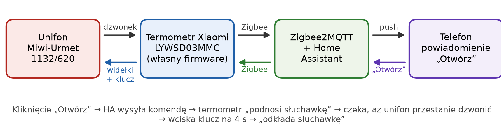
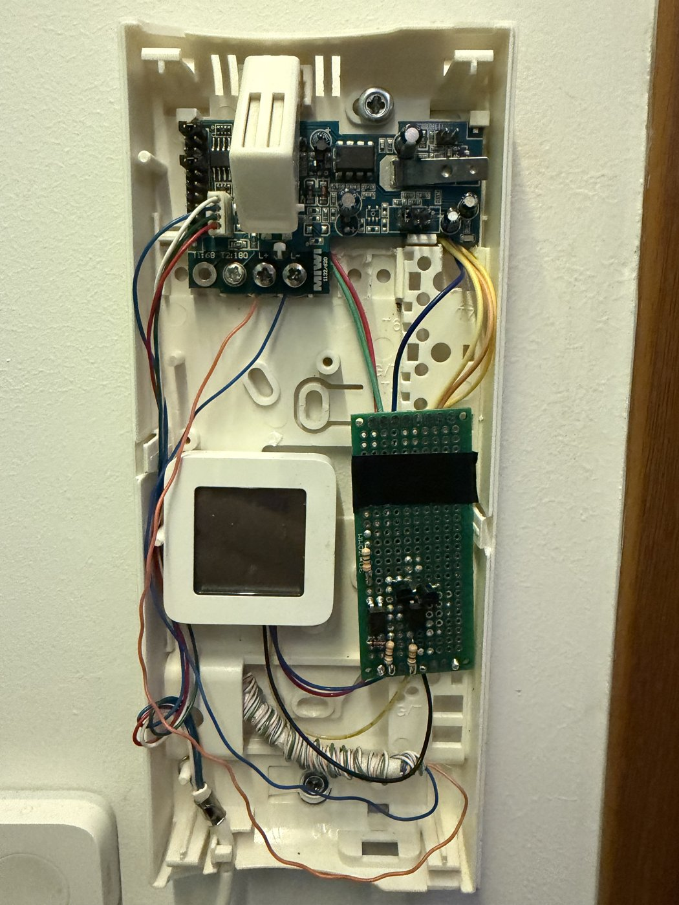
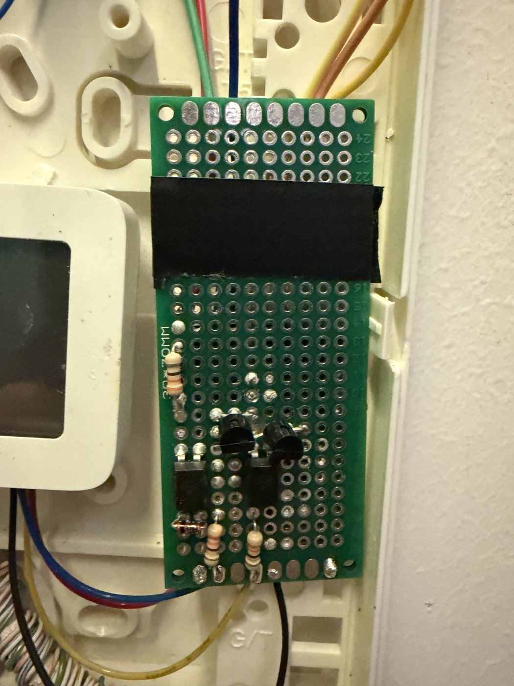

# Domofon Miwi-Urmet 1132/620 z Zigbee i Home Assistant

**Zwykły domofon, powiadomienia na telefon i otwieranie drzwi jednym dotknięciem.** Bez wymiany unifonu, bez podnoszenia słuchawki i bez ingerencji w magistralę budynku.

Sercem projektu jest… termometr **Xiaomi LYWSD03MMC**. Po zmianie oprogramowania na zmodyfikowany [ZigbeeTLc](https://github.com/pvvx/ZigbeeTLc) działa jako sterownik domofonu. Potrzeba jeszcze kilku prostych elementów elektronicznych.

Projekt powstał dla **Miwi-Urmet 1132/620 (starsza wersja płytki)**. Nie zakładaj, że oznaczenia styków będą takie same w innym unifonie.

**[Instrukcja montażu krok po kroku](docs/MONTAZ.md)** · [Dokumentacja ze schematami (PDF)](docs/domofon-miwi-urmet-home-assistant.pdf)



## Co potrafi?

- Wykrywa dzwonek domofonu i wysyła powiadomienie przez Home Assistant.
- Pozwala otworzyć drzwi bezpośrednio z powiadomienia na telefonie.
- Elektronicznie symuluje podniesienie słuchawki i naciśnięcie przycisku otwierania.
- Pozostawia normalne działanie oryginalnego unifonu.
- Pilnuje, żeby polecenie otwarcia można było wykonać tylko w określonym czasie po dzwonku.
- Umożliwia monitorowanie łączności urządzenia w Home Assistant.

## Jak to działa?

1. Gość naciska przycisk przy wejściu. Układ wykrywa dzwonek, a **Home Assistant wysyła powiadomienie z przyciskiem „Otwórz drzwi”**.
2. Po naciśnięciu przycisku sterownik zwiera styki przełącznika widełkowego, symulując podniesienie słuchawki.
3. Sterownik czeka na ustanie sygnału dzwonka, co pozwala rozpoznać odebranie połączenia.
4. Następnie na **4 sekundy** uruchamia obwód otwierania drzwi i przywraca unifon do stanu spoczynku.

Otwieranie rozpoczyna się zwykle po około **2–3 sekundach od wydania polecenia**. Cała sekwencja trwa dłużej, bo sterownik musi jeszcze zakończyć naciskanie przycisku i „odłożyć” słuchawkę.

| Unifon po przeróbce | Elektronika sterująca |
|---|---|
|  |  |

## Co będzie potrzebne?

| Element | Ilość | Zastosowanie |
|---|---:|---|
| Xiaomi LYWSD03MMC (testowana wersja sprzętowa B1.4) | 1 | Sterownik Zigbee |
| Transoptor EL817C lub PC817 | 2 | Wykrywanie dzwonka (U1) i sterowanie widełkami (U3) |
| Tranzystor BC547 lub odpowiedni małosygnałowy NPN | 2 | Sterowanie widełkami i przyciskiem otwierania |
| Rezystor 1 kΩ | 1 | Obwód wykrywania dzwonka |
| Rezystor 330 Ω | 2 | Sterowanie U3 i tranzystorem otwierania |
| Dioda 1N4148 | 1 | Zabezpieczenie diody wejściowej U1 |

## Podłączenie do unifonu

Poniższe połączenia dotyczą przetestowanego egzemplarza **Miwi-Urmet 1132/620**. Przed lutowaniem sprawdź swoją wersję płytki i porównaj ją ze schematami.

| Funkcja | Wyprowadzenie termometru | Podłączenie w unifonie | Schemat |
|---|---|---|---|
| Wykrywanie dzwonka | **P8 (PA6)** – wejście aktywne stanem niskim | Czerwony i zielony przewód głośnika słuchawki | [Dzwonek](docs/img/s_dzwonek.png) |
| Symulacja podniesienia słuchawki | **P9 (PC4)** | Styki **2 i 4** przełącznika widełkowego | [Widełki](docs/img/s_widelki.png) |
| Otwieranie drzwi | **P7 (PD7)** | Nit (+) i blaszka (masa) przycisku otwierania | [Przycisk](docs/img/s_klucz.png) |

Masa termometru jest połączona z blaszką przycisku, czyli masą unifonu. **P14 (SWS)** pozostaw dostępny — służy do przewodowego wgrywania firmware.

> [!WARNING]
> **Nie podłączaj niczego do zacisku L+.** W tej instalacji jest to magistrala komunikacyjna budynku, a nie punkt zasilania. Podczas prób pobrania z niej sygnału komunikacja przestała działać, a panel wejściowy wyświetlił błąd „error”. Błędne podłączenie może zakłócić działanie domofonów również u sąsiadów.

## Oprogramowanie sterownika

Firmware bazuje na projekcie [pvvx/ZigbeeTLc](https://github.com/pvvx/ZigbeeTLc). Dodano obsługę dzwonka, przełącznika widełkowego i przycisku otwierania. Zmiany obejmują około 240 linii w 10 plikach, w tym nowe `src/domofon.c` i `src/domofon.h`.

W repozytorium znajdują się:

| Ścieżka | Zawartość |
|---|---|
| `firmware/patches/` | Pięć patchy Git do nałożenia na wersję bazową `c915b52` |
| `firmware/domofon-vs-upstream-c915b52.diff` | Te same modyfikacje zapisane w jednym pliku diff |
| `firmware/bin/Z03MMC_domofon.bin` | Firmware do wgrywania przewodowego / przez TelinkMiFlasher |
| `firmware/bin/1141-020a-20043001-Z03MMC.zigbee` | Firmware OTA dla Zigbee2MQTT (wersja `0x20043001`) |

### Wgrywanie firmware

**Jeśli termometr ma już ZigbeeTLc**, można skorzystać z aktualizacji OTA w Zigbee2MQTT:

1. Umieść plik `.zigbee` oraz `homeassistant/zigbee2mqtt/index.json` w katalogu `ota_domofon/` obok konfiguracji Zigbee2MQTT.
2. W konfiguracji Zigbee2MQTT wskaż plik indeksu OTA. Używane w projekcie ustawienie to `ota.zigbee_ota_override_index_location: ota_domofon/index.json`.
3. Uruchom aktualizację urządzenia. W przeprowadzonych testach zajmowała około **25 minut**.

**Jeśli termometr ma fabryczny firmware**, najpierw przeprowadź instalację ZigbeeTLc zgodnie z [instrukcjami autora](https://github.com/pvvx/ZigbeeTLc). Potem wykonaj aktualizację OTA opisaną powyżej. Plik `Z03MMC_domofon.bin` jest przeznaczony do wgrywania przewodowego przez SWS.

### Samodzielna kompilacja

Projekt bazuje na commicie `c915b52` ZigbeeTLc. Poniższe polecenia uruchom z katalogu nadrzędnego, w którym znajduje się sklonowane repozytorium z patchami. Dzięki temu ścieżka `../firmware/patches/` będzie poprawna tylko wtedy, gdy odpowiednio przygotujesz układ katalogów. W przeciwnym razie podaj pełną ścieżkę do plików `.patch`:

```bash
git clone https://github.com/pvvx/ZigbeeTLc.git && cd ZigbeeTLc
git checkout -b domofon c915b52
git am ../firmware/patches/*.patch
make -s -j8 VERSION_BIN=_domofon PROJECT_NAME=Z03MMC \
  POJECT_DEF="-DBOARD=BOARD_LYWSD03MMC -DUSE_DOMOFON=1" \
  ZNAME="DIY:DOMOFON-z" PYTHON=python3 BIN_PATH=./out_domofon
```

Do kompilacji wymagany jest toolchain Telink opisany w dokumentacji ZigbeeTLc. **Uwaga:** polecenie `git am` zakłada, że folder `firmware/patches/` znajduje się obok sklonowanego katalogu `ZigbeeTLc`.

**Sumy kontrolne SHA-256** udostępnionych obrazów:

```text
59ed7929cebf7cf468276326f5630b1118c164847b2ef48809e854a7fa9e4d6e  Z03MMC_domofon.bin
255a72d274bb0a41affa6561dce3be4260f697fce127411b0b5f4e0940920d75  1141-020a-20043001-Z03MMC.zigbee
```

### Co dokładnie robi firmware podczas otwierania?

| Etap | Zachowanie sterownika |
|---|---|
| Podniesienie słuchawki | Zwiera styki 2–4 |
| Wykrycie odebrania | Co 100 ms sprawdza dzwonek; po co najmniej 1 s od podniesienia uznaje ciszę trwającą ≥ 1,2 s za odebranie |
| Otwarcie drzwi | Czeka 0,3 s, uruchamia przycisk na 4 s, czeka kolejne 0,5 s i zwalnia widełki |
| Próba naprawienia problemu z widełkami | Jeśli po 2,5 s dzwonek nadal działa, zwalnia widełki na 0,4 s i podnosi je ponownie; maksymalnie 2 próby |
| Brak sygnału dzwonka w chwili polecenia | Uruchamia przycisk po 3 s |

Czasy można zmieniać w `src/board_lyws03mmc.h` (stałe `DOMOFON_*`).

Po wykryciu dzwonka urządzenie przez 60 sekund częściej sprawdza komunikację z koordynatorem Zigbee, aby szybciej odebrać polecenie otwarcia. Wyświetlacz termometru jest wyłączony w celu ograniczenia poboru energii z baterii CR2032.

## Integracja z Home Assistant

Gotowe pliki konfiguracyjne znajdziesz w katalogu `homeassistant/`:

| Plik | Za co odpowiada? |
|---|---|
| [`zigbee2mqtt/external_converters/domofon.mjs`](homeassistant/zigbee2mqtt/external_converters/domofon.mjs) | Udostępnia urządzenie `DOMOFON-z` w Zigbee2MQTT |
| [`automations.yaml`](homeassistant/automations.yaml) | Wysyła powiadomienie z przyciskiem „Otwórz”, obsługuje jego naciśnięcie i wykrywa utratę łączności |
| [`scripts.yaml`](homeassistant/scripts.yaml) | Sprawdza warunki bezpieczeństwa przed wysłaniem polecenia otwarcia |

W konfiguracji zastąp `notify.mobile_app_TWOJ_TELEFON` nazwą usługi powiadomień swojego telefonu. Sprawdź również identyfikatory encji i automatyzacji — zależą od nazw utworzonych w Twoim Home Assistant.

**Ważne:** przykładowy skrypt dopuszcza otwarcie tylko w ciągu **60 sekund od dzwonka** i tylko raz dla danego wywołania. To zabezpieczenie przed przypadkowym uruchomieniem otwierania poza aktywną wizytą.

## Co wyszło podczas testów?

Kilka rzeczy, które oszczędzą czasu przy podobnej przeróbce:

- **Sam transoptor nie wystarczył** do sterowania widełkami ani przyciskiem. Problemem był dostępny prąd i spadek napięcia. Pomogło użycie tranzystorów.
- **Mechaniczny przełącznik widełkowy potrafił się zacinać.** Dlatego firmware może automatycznie ponowić jego przełączenie.
- **Otwieranie bez wcześniejszego dzwonka nie działało** w testowanej centrali (funkcja T1, zacisk T2:180 była wyłączona).
- **Logi Zigbee2MQTT pomagają w diagnozie.** Jeśli stan „dzwoni” utrzymuje się przez cały czas symulowanego podniesienia słuchawki, centrala prawdopodobnie nie zarejestrowała odebrania połączenia.

## Bezpieczeństwo i zgodność

To opis działającego prototypu, **nie uniwersalna instrukcja dla wszystkich instalacji Miwi-Urmet**. Modyfikujesz urządzenie podłączone do wspólnej infrastruktury budynku, więc wykonujesz prace na własne ryzyko. Nie ingeruj w centralę ani magistralę budynku. Przed podłączeniem elektroniki zweryfikuj styki, napięcia i sposób działania swojego unifonu.

## Autorzy i licencje

Projekt wykorzystuje [ZigbeeTLc autorstwa pvvx](https://github.com/pvvx/ZigbeeTLc) — podziękowania za udostępnienie firmware i dokumentacji.

Pliki tego repozytorium są opisane w [LICENSE](LICENSE). Modyfikacje firmware bazują na ZigbeeTLc i podlegają również warunkom licencyjnym projektu źródłowego.
