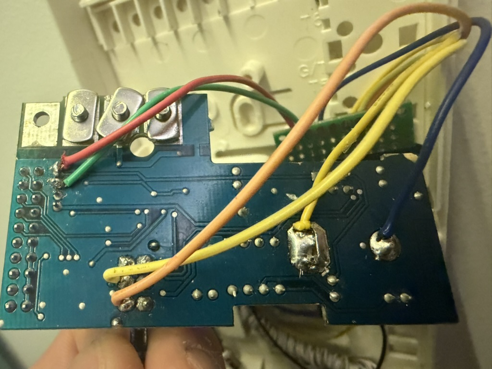
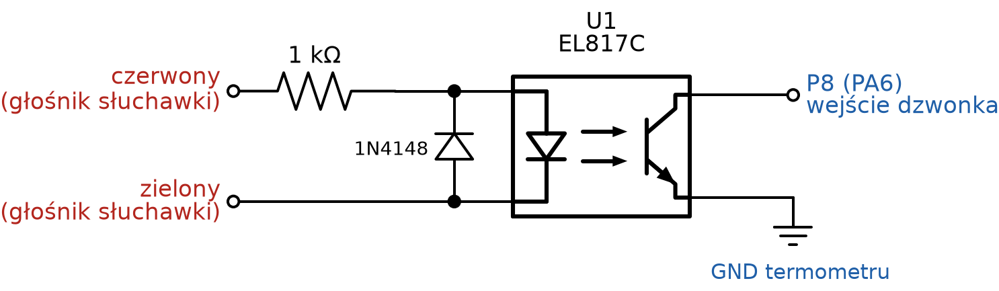
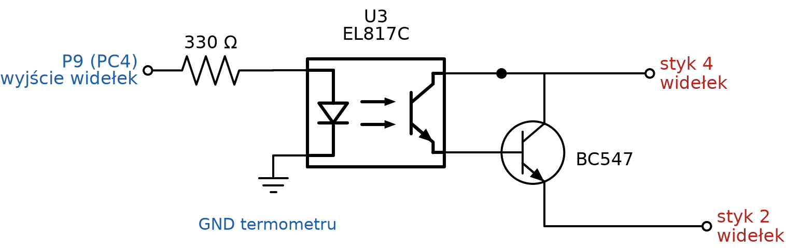
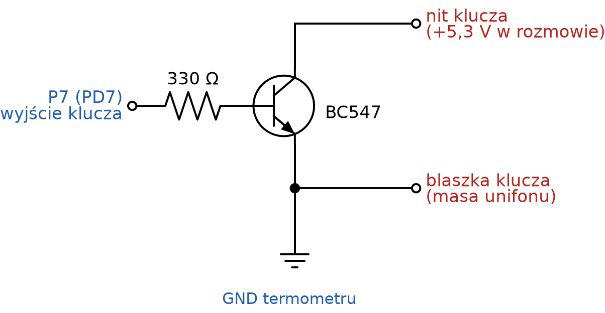

# Montaż domofonu Zigbee – Miwi-Urmet 1132/620

Ten poradnik opisuje **konkretny, przetestowany egzemplarz** Miwi-Urmet 1132/620 (starsza rewizja płytki) oraz sterownik oparty na Xiaomi LYWSD03MMC HW B1.4. **Sterownik jest zasilany z baterii CR2032 termometru i nie wymaga żadnego dodatkowego zasilacza ani doprowadzania zasilania z domofonu.** Powstał na podstawie pomiarów i schematów zamieszczonych w [dokumentacji PDF](domofon-miwi-urmet-home-assistant.pdf).

> [!CAUTION]
> **Nie podłączaj się do L+ ani L− w instalacji budynku.** W opisywanym systemie jest to wspólna magistrala cyfrowa (w pomiarach około 11,5 V). Próba wykorzystania L+ do wykrywania sygnału zakłóciła pracę całego systemu. Wszystkie połączenia sterownika wykonano po stronie elementów unifonu, zgodnie ze schematami. Przed pracą odłącz unifon od instalacji. Jeśli nie masz pewności, jak zweryfikować styki, nie montuj układu metodą prób i błędów.

## Zasilanie — dlaczego ten projekt nie potrzebuje zasilacza?

Elektronika sterownika i komunikacja Zigbee korzystają z **baterii CR2032 w Xiaomi LYWSD03MMC**. Połączenia do unifonu służą do wykrywania dzwonka i sterowania jego istniejącymi funkcjami, **nie do zasilania termometru**. Nie podłączaj zasilania z magistrali budynku. Firmware ogranicza pobór energii, m.in. wyłączając wyświetlacz i zmieniając aktywność urządzenia po dzwonku. Nie ma jeszcze opublikowanego, wiarygodnego pomiaru żywotności jednej baterii.

## 1. Zanim zaczniesz

Potrzebujesz termometru Xiaomi LYWSD03MMC, dwóch transoptorów EL817C/PC817, dwóch tranzystorów BC547, rezystora 1 kΩ, dwóch rezystorów 330 Ω, diody 1N4148, płytki uniwersalnej i cienkich przewodów. Przydadzą się multimetr, lutownica oraz materiały do izolacji połączeń.

**Ważne:** sam termometr z fabrycznym firmware nie będzie działał jako sterownik. Najpierw trzeba wgrać odpowiednio zmodyfikowany firmware ZigbeeTLc. Opis plików i sposobu aktualizacji jest w [README](../README.md#oprogramowanie-sterownika).

Zrób zdjęcie swojej płytki przed lutowaniem. Nie kieruj się wyłącznie kolorem przewodu: opis czerwonego i zielonego przewodu dotyczy konkretnego egzemplarza.

## 2. Znajdź trzy miejsca podłączenia

Na oryginalnym unifonie wykorzystujemy:

1. **Głośnik słuchawki** – na jego czerwonym i zielonym przewodzie pojawia się sygnał dzwonka. W testowanym egzemplarzu głośnik miał około 450 Ω.
2. **Przełącznik widełkowy** – zwarcie styków **2–4** odpowiada podniesieniu słuchawki.
3. **Przycisk otwierania drzwi** – ma dwa styki: nit (podczas rozmowy około +5,3 V) oraz blaszka (masa unifonu).

Zmierzone połączenia przełącznika widełkowego **od strony spodniej**:

| Kolumna styków | Słuchawka odłożona | Słuchawka podniesiona |
|---|---|---|
| Lewa: 1–3–5 | 3–5 | 1–3 |
| Prawa: 2–4–6 | 4–6 | **2–4** |

W opisywanej płytce pin 3 jest połączony z masą unifonu (blaszką przycisku), a pin 5 z czerwonym przewodem głośnika. **Nie trzeba przecinać ścieżek ani usuwać oryginalnych elementów**.

### Zdjęcie rzeczywistego montażu — strona lutowania

[Otwórz oryginalne zdjęcie w pełnym rozmiarze](img/unifon_lutowania.jpeg).

To fotografia **konkretnego, działającego egzemplarza** unifonu, pokazująca połączenia od strony ścieżek. Zdjęcie nie jest opisane strzałkami: przed lutowaniem porównaj punkty ze schematami oraz potwierdź funkcje styków miernikiem. Kolory przewodów nie stanowią uniwersalnego standardu dla innych rewizji płytki.

## 3. Podłącz wykrywanie dzwonka

Obwód wykrywania dzwonka wykorzystuje transoptor **U1 (EL817C/PC817)**.

- Czerwony przewód głośnika prowadzi przez **rezystor 1 kΩ** do obwodu diody wejściowej U1.
- Zielony przewód stanowi drugi punkt wejściowy.
- **1N4148** chroni diodę transoptora przed odwrotną połówką zmiennego sygnału dzwonka; jej polaryzację odczytaj ze schematu.
- Wyjście transoptora podaje sygnał na **P8 (PA6)** termometru, zwierając to wejście do masy termometru przy wykryciu dzwonka.

Szczegóły rozmieszczenia nóżek transoptora sprawdź z oznaczeniem i notą katalogową **konkretnego elementu**. Schemat pokazuje funkcje połączeń, nie widok obudowy od góry.

Firmware traktuje to wejście jako czujnik zajętości (`occupancy`). Każdy impuls podtrzymuje stan dzwonka przez około 3 sekundy.

## 4. Podłącz symulację podniesienia słuchawki

Sterowanie widełkami wykorzystuje **U3 (EL817C/PC817)** oraz **BC547**:

- **P9 (PC4)** termometru steruje diodą U3 przez rezystor **330 Ω**.
- Układ transoptora i tranzystora odpowiada za zwarcie styków **4 i 2** przełącznika widełkowego.
- W testowanej instalacji sam transoptor nie przewodził wystarczającego prądu, aby centrala rozpoznała odebranie; tranzystor usunął problem.

Podłącz według [schematu widełek](img/s_widelki.png), uwzględniając prawidłową kolejność wyprowadzeń tranzystora. Nie wykonuj zastępczego połączenia 2–4 na stałe — unifon musi nadal normalnie reagować na odłożenie i podniesienie słuchawki.

## 5. Podłącz przycisk otwierania

Otwieranie realizuje drugi **BC547**:

- **P7 (PD7)** steruje bazą tranzystora przez rezystor **330 Ω**.
- Obwód wyjściowy tranzystora podłączony jest do **nitu przycisku (+)** i **blaszki przycisku (masa unifonu)**.
- **GND termometru trzeba połączyć z masą unifonu** przy blaszce przycisku.

To ostatnie połączenie jest niezbędne dla sterowania bazą tranzystora. Podczas prób układ z samym transoptorem lub dodatkowym transoptorem pozostawiał na przycisku około 0,1–0,8 V i działał niepewnie.

**Uwaga o izolacji:** transoptory występują w obwodach dzwonka i widełek, ale obwód klucza ma **wspólną masę termometru i unifonu**. Nie opisuj więc całej modyfikacji jako całkowicie galwanicznie odizolowanej.

## 6. Połączenia z termometrem

| Pad | GPIO układu | Funkcja |
|---|---|---|
| **P8** | PA6 | Wejście wykrywania dzwonka, aktywne stanem niskim |
| **P9** | PC4 | Sterowanie widełkami |
| **P7** | PD7 | Sterowanie otwieraniem |
| **P14 (SWS)** | — | Zostaw dostępny do programowania przewodowego |
| **GND** | — | Masa układu, wspólna z blaszką przycisku otwierania |

Nie zakładaj, że GPIO są odporne na napięcia występujące bezpośrednio w unifonie. Wykonaj obwody pośredniczące ze schematów, zamiast łączyć pady termometru bezpośrednio z elementami unifonu.

## 7. Sprawdzenie przed zamknięciem obudowy

Po wykonaniu lutowania, **przed ponownym podłączeniem unifonu do instalacji**:

1. Obejrzyj wszystkie połączenia i sprawdź, czy nie ma mostków lutowniczych.
2. Sprawdź multimetrem ciągłość zamierzonych połączeń oraz brak przypadkowych zwarć.
3. Zweryfikuj orientację diody 1N4148 i wyprowadzenia obu transoptorów oraz tranzystorów.
4. Upewnij się, że **nie wykonano żadnego połączenia do magistrali L+ / L−**.
5. Sprawdź, czy przewody nie będą przygniatane przez obudowę ani blokować mechanizmu widełek.

Po ponownym podłączeniu do instalacji i uruchomieniu firmware sprawdź kolejno: **zwykłe dzwonienie i rozmowę**, wykrywanie dzwonka w Zigbee2MQTT, polecenie otwierania oraz powrót przełącznika widełkowego do stanu spoczynku.

Nie testuj otwierania bez połączenia z panelu wejściowego: w badanej centrali funkcja otwierania bez wywołania była wyłączona.

## 8. Zigbee2MQTT i Home Assistant

1. Dodaj [konwerter zewnętrzny](../homeassistant/zigbee2mqtt/external_converters/domofon.mjs) do swojej konfiguracji Zigbee2MQTT.
2. Sparuj urządzenie z firmware domofonu jako `DOMOFON-z`.
3. Sprawdź, czy zdarzenie dzwonka zmienia encję odpowiadającą `occupancy`, a sterowanie `on/off` uruchamia sekwencję.
4. Skonfiguruj przykłady [automatyzacji](../homeassistant/automations.yaml) i [skryptu otwierania](../homeassistant/scripts.yaml).
5. Podmień `notify.mobile_app_TWOJ_TELEFON` na swoją usługę i **sprawdź rzeczywiste identyfikatory encji** w Home Assistant.

Przykładowy skrypt ogranicza wydanie polecenia otwarcia do **60 sekund po dzwonku** i blokuje wielokrotne otwieranie przy tym samym wywołaniu. Automatyzacja alarmuje o braku wiadomości od domofonu przez ponad **15 minut**, gdy połączenie z mostkiem Zigbee2MQTT jest aktywne.

> [!IMPORTANT]
> Przykładowe pliki YAML wymagają dopasowania do własnej instalacji. Samo skopiowanie ich do HA nie gwarantuje działania bez zmiany nazw encji, usług i ewentualnie ustawień Zigbee2MQTT.

## 9. Jeśli coś nie działa

| Objaw | Co sprawdzić |
|---|---|
| Brak powiadomienia, chociaż unifon dzwoni | Obwód U1, polaryzację 1N4148, połączenie P8 i stan `occupancy` w Zigbee2MQTT |
| Dzwonek w logach trwa mimo symulowanego podniesienia słuchawki | Styki 2–4, obwód U3 + BC547 oraz mechanikę przełącznika widełkowego |
| Centrala przyjęła połączenie, ale drzwi się nie otwierają | Obwód P7, połączenie GND z blaszką, styk nitu przycisku |
| Otwieranie działa tylko czasami | Sprawdź spadek napięcia na obwodzie przycisku; wersje z transoptorem dawały w testach zbyt duży spadek |
| Polecenie „Otwórz” jest ignorowane | Zweryfikuj okno 60 s, czy nie wykorzystano już polecenia, dostępność Zigbee oraz nazwy encji |
| Panel wejściowy zgłasza błąd | Odłącz modyfikację od unifonu i zweryfikuj poprawność połączeń; szczególnie upewnij się, że nie dotknięto magistrali budynku |

## Materiały

- [Schemat blokowy](img/s_blokowy.png)
- [Dzwonek – U1](img/s_dzwonek.png)
- [Widełki – U3 i BC547](img/s_widelki.png)
- [Otwieranie – BC547](img/s_klucz.png)
- [Pełny opis pomiarów, firmware i zdjęć (PDF)](domofon-miwi-urmet-home-assistant.pdf)

> **W przygotowaniu:** oznaczone zdjęcie oryginalnej płytki unifonu ze wskazaniem rzeczywistych punktów lutowania. Do jego dodania schematy i pomiary są jedynym źródłem lokalizacji połączeń w tej wersji układu.

## 10. Przykład działania na iPhonie

W działającym układzie po naciśnięciu przycisku przy wejściu iPhone pokazuje powiadomienie **„Domofon 🔔 — Ktoś przy klatce”**. Po rozwinięciu powiadomienia pojawiają się akcje **„Otwórz drzwi 🔓”** i **„Ignoruj 🚫”**. Są to zrzuty ekranu z działającej instalacji Home Assistant, a nie wizualizacje koncepcyjne. Wygląd i uprawnienia powiadomień zależą od wersji iOS oraz konfiguracji aplikacji Home Assistant.
